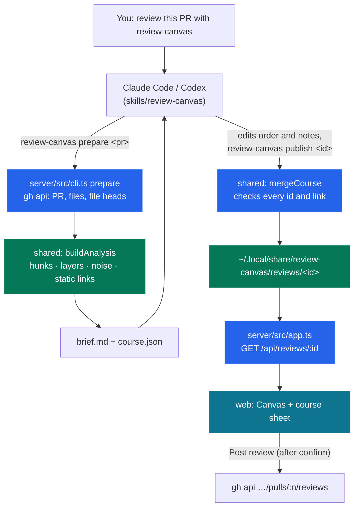

# Review Canvas

Review a pull request on an infinite canvas, file by file, in the order your coding agent
planned.

Ask Claude Code or Codex to review a PR with the `review-canvas` skill. The agent plans the
review and replies with a link. The canvas shows each file as a frame on a map:

- a purple course runs from file to file in reading order;
- dashed lines join hunks that refer to each other;
- layer bands run top to bottom: data, domain, jobs, mail, HTTP, frontend;
- tests sit under the code they cover, and generated files sit under their source;
- noise (tests, translations, generated API clients) can be filtered out of the way.

You punch each file as you review it, draft comments on lines, and post one GitHub review when
you are done.

## How it works



The split is deliberate:

- **The server is deterministic.** It parses hunks, assigns layers by path, classifies noise, and
  finds links only where the code shows them. A symbol defined in one hunk has to be used in
  another hunk's changed lines.
- **The agent supplies judgement.** It writes the reading order, the "What" and "Why here" notes
  for each file, and one line per hunk. It may propose extra links, but each must name a symbol
  that appears in both hunks. The server rejects any link that doesn't, so the map never shows a
  relationship the code lacks.
- **Nothing reaches GitHub without you.** Drafts stay local until you press Post review and
  confirm.

## Run it

Needs Node 22+, the [GitHub CLI](https://cli.github.com/) logged in (`gh auth login`), and
optionally Tailscale.

```bash
npm install
npm run build
npm run install:skill      # links the skill into ~/.agents, ~/.claude, ~/.codex and the CLI into ~/.local/bin
review-canvas setup        # serve over Tailscale HTTPS; or: review-canvas setup --public-url http://localhost:4790
review-canvas demo         # a synthetic PR with a planned course, to try the UI
```

Then, in Claude Code or Codex:

> review https://github.com/owner/repo/pull/123 with review-canvas

## CLI

| Command | What it does |
| --- | --- |
| `review-canvas prepare <pr>` | Fetch and analyze a PR; write the brief and a pre-filled course JSON. |
| `review-canvas publish <id> [course.json]` | Check the course, save it, start the server, print the URL. |
| `review-canvas open <pr>` | Prepare and open in the default layer order, without an agent. |
| `review-canvas demo` | Load the synthetic demo PR. |
| `review-canvas up` · `stop` · `restart` · `serve` | Manage the server (port 4790, bound to 127.0.0.1). |
| `review-canvas setup [--public-url URL]` | Choose the URL reviews open at. With no URL, uses `tailscale serve`. |

## Keyboard

`N`/`P` next or previous file · `X` punch and move on · `F` whole course · `0` 100% ·
`+`/`-` zoom · `Space`+drag pan · `⌘`/`Ctrl`+scroll zoom · `Esc` close panels.

## Develop

```bash
npm run dev        # shared watch + server (tsx) + web (vite, proxies /api to :4790)
npm test           # vitest: parser, layers, noise, links, course merge, layout, API
npm run typecheck
```

- [`docs/PRODUCT.md`](docs/PRODUCT.md): who it is for and its principles.
- [`docs/DESIGN.md`](docs/DESIGN.md): the orienteering-map visual system.
- [`AGENTS.md`](AGENTS.md): rules for working on this repo.

The committed fixture in `test/fixtures/` is a synthetic PR. Never commit real PR content from
private repositories.
