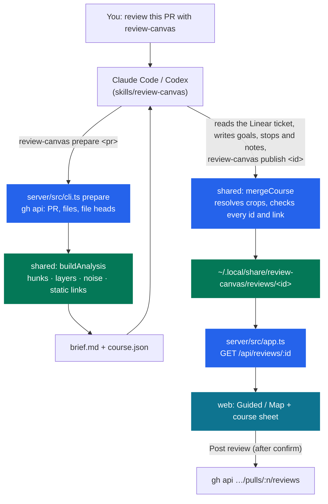

# Review Canvas

Review a pull request one goal at a time, with the chunks and test source that check each goal, in the
order your coding agent planned.

Ask Claude Code or Codex to review a PR with the `review-canvas` skill. The agent reads the PR
and its Linear ticket (or the PR description when there is none), turns the ticket's goals into
a course, and replies with a link. The page has two views over the same review:

- **Guided** walks one goal at a time. Its chunks are stops in reading order, joined by a purple
  route, with its tests last. A goal with no proving test shows a gap. A last stop, "Changes no
  goal asked for", lists every changed chunk that no goal cites.
- **Map** shows every changed file open on its layer band (data, domain, jobs, mail, HTTP,
  frontend), with the goal numbers on each chunk. Generated output and generated API clients sit
  in a collapsed "Out of bounds" band; translations stay on the course.

On either view:

- each chunk has a short summary from the agent, and a few line notes where a line needs one;
- link buttons (Uses, Used by, Tested by) open a side drawer with the related chunk and the
  symbol highlighted, and Open file shows the whole file at the PR head;
- code is syntax-highlighted, with Show more lines above and below, pinch zoom and Space+drag pan;
- chunks count as read as you scroll past them, and you press Mark reviewed (or `X`) to finish a
  goal.

You draft comments on lines and post one GitHub review when you are done.

Evidence adds recorded command output and structured observations, explicit run comparison,
exact source changes since a reviewed revision, and deployment analysis. Reading test source
does not establish that a test ran or passed. Playback only reads stored data.

## How it works



The split is deliberate:

- **The server is deterministic.** It parses hunks, assigns layers by path, classifies noise, and
  finds links only where the code shows them. A symbol defined in one hunk has to be used in
  another hunk's changed lines. At publish it checks every stop, every crop and every note, and
  repairs or drops what doesn't match, with a warning.
- **The agent supplies judgement.** It writes the goals, the chunk stops for each (tests last),
  a summary of at most 90 characters for every chunk, and a few line notes. It may propose extra
  links, but each must name a symbol that appears in both hunks. The server rejects any link that
  doesn't, so the page never shows a relationship the code lacks.
- **Nothing reaches GitHub without you.** Drafts stay local until you press Post review and
  confirm.

## Run it

Needs Node 22+, the [GitHub CLI](https://cli.github.com/) logged in (`gh auth login`), and
optionally Tailscale.

```bash
npm install
npm run build
npm run install:skill      # links the skill into ~/.agents, ~/.claude, ~/.codex and the CLI into ~/.local/bin
review-canvas setup        # serve over Tailscale HTTPS; or: review-canvas setup --public-url http://localhost:4790
review-canvas demo         # a synthetic PR with a goal course, to try the UI
```

Then, in Claude Code or Codex:

> review https://github.com/owner/repo/pull/123 with review-canvas

## CLI

| Command | What it does |
| --- | --- |
| `review-canvas prepare <pr>` | Fetch and analyze a PR; write the brief and a course JSON template. |
| `review-canvas publish <id> [course.json]` | Check the course, save it, start the server, print the URL and any warnings. |
| `review-canvas open <pr>` | Prepare and open in the Map view without goals, without an agent. |
| `review-canvas demo` | Load the synthetic demo PR. |
| `review-canvas up` · `stop` · `restart` · `serve` | Manage the server (port 4790, bound to 127.0.0.1). |
| `review-canvas setup [--public-url URL]` | Choose the URL reviews open at. With no URL, uses `tailscale serve`. |
| `review-canvas evidence record <id> --scenario <manifest.json> --out <bundle.json> [--cwd <path>] [--timeout-ms <ms>] -- <command> [args...]` | Run explicit argv locally and write an artifact; does not import it. |
| `review-canvas evidence import <id> <bundle.json>` | Validate and import a bundle with an `imported-file` receipt. |
| `review-canvas evidence list <id> --json` | List runs, provenance, capture gaps, freshness and goal bindings. |
| `review-canvas evidence show <id> <run-id> --json` | Inspect the bundle and its import receipt. |
| `review-canvas evidence compare <id> --left <run> --right <run> [--mode runs\|base-head] --json` | Compare selected runs or report why they are incomparable. |
| `review-canvas revisions <id> [--baseline <review-id>] --json` | Select a reviewed baseline and compare exact endpoint trees. |
| `review-canvas deployment import <id> <file.json>` · `deployment show <id> --json` | Store or inspect deployment claims and evidence qualifications. |

The inspection commands also work without `--json`. See [docs/EVIDENCE.md](docs/EVIDENCE.md)
for the manifest, line protocol, executable Node example and deployment fields. New preparation
rechecks the repository, PR and endpoint SHAs after fetching files, and refuses a mixed snapshot.

## Keyboard

`J`/`K` next or previous stop · `]`/`[` next or previous goal · `X` mark the goal reviewed ·
`F` whole course · `M` Map view · `G` Guided view · `Space`+drag pan · `⌘`/`Ctrl`+scroll or pinch
zoom · `Esc` close the drawer, then the composer.

## Develop

```bash
npm run dev        # shared watch + server (tsx) + web (vite, proxies /api to :4790)
npm test           # vitest: parser, layers, noise, links, crops, course merge, API
npm run typecheck
```

- [`docs/PRODUCT.md`](docs/PRODUCT.md): who it is for and its principles.
- [`docs/DESIGN.md`](docs/DESIGN.md): the orienteering-map visual system, including the agent-note style.
- [`AGENTS.md`](AGENTS.md): rules for working on this repo.

The committed fixture in `test/fixtures/` is a synthetic PR. Never commit real PR content from
private repositories.
