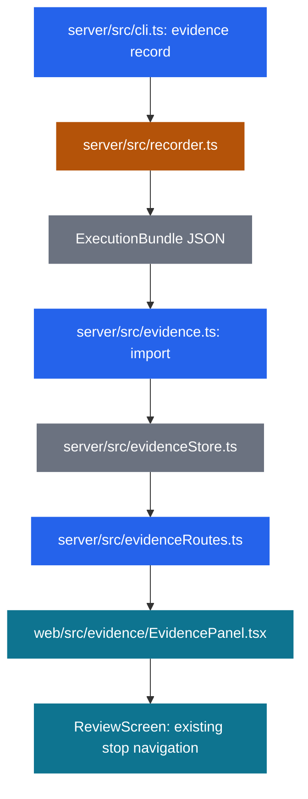
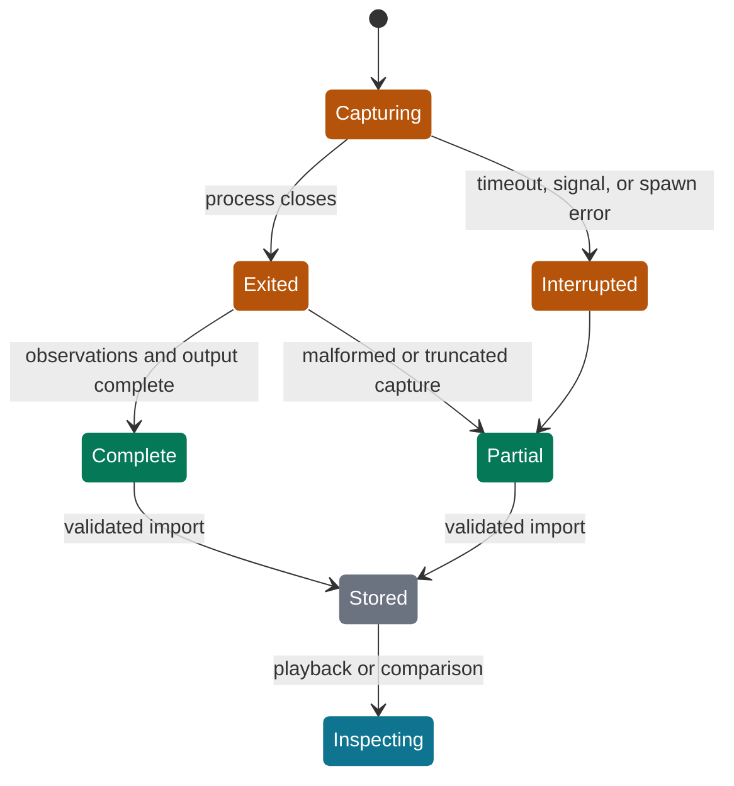
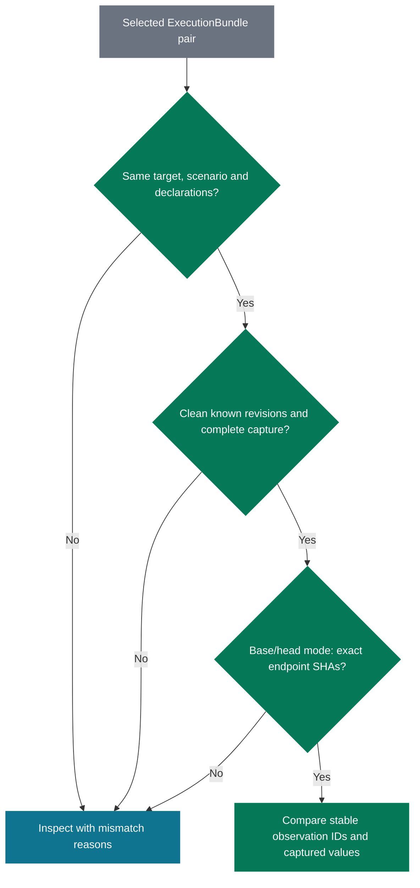

# Recorded Review Evidence - Plan

## Goal Capsule

- **Objective:** A reviewer can inspect what a change actually did, compare it with earlier code, and judge deployment risks without running the branch in their browser session.
- **Means:** Extend the existing goal course with recorded execution bundles, scenario playback, revision comparison, and deployment evidence (KTD1–KTD8).
- **Authority:** The Product Contract controls behavior. Technical decisions control its implementation. `AGENTS.md`, `docs/PRODUCT.md`, and `docs/DESIGN.md` supply the existing product and code constraints.
- **Execution:** The integrating agent assigns bounded units to workers, integrates their changes, and owns whole-change verification and review. Workers implement every code change. Independent file sets may run in parallel as specified below.
- **Finish:** Ship a verified draft PR with no AI attribution. No merge, production deployment, GitHub review, issue comment, or review-thread reply is authorized by this plan.
- **Stop condition:** Return a blocker if implementation would require dropping one of the four capabilities, fabricating observed evidence, or changing an agreed product constraint.

---

## Product Contract

### Summary

Add execution evidence to the existing goal-based review. An author records a real command and its structured observations locally, then imports the artifact into the review. The reviewer steps through those observations, compares runs at explicit revisions, sees changes since an earlier reviewed revision, and inspects deployment compatibility, backfills, and rollback constraints.

### Problem Frame

Review Canvas currently displays changed source and test source. Neither proves that a scenario ran or reveals its responses, record changes, events, or jobs. Separate review snapshots do not explain behavioral changes between revisions, and schema changes lack a dedicated deployment view.

### Key Decisions

- **Deliver all four gaps in Review Canvas.** (session-settled: user-directed — chosen over a documentation-only skill, screenshot attachment, or evidence-only MVP: the user requested implementing the identified gaps.) Governs R1–R10.
- **Keep observations separate from agent interpretation.** (session-settled: user-approved — chosen over treating an LLM explanation as runtime proof: the reviewer must distinguish captured behavior from inferred explanation.) Governs R2, R5, R10.
- **Extend the incumbent application and design.** Governs R11–R13. A separate app, hosted model service, new datastore, or visual redesign would interrupt the existing review workflow.

### Requirements

**Recording and evidence**

- R1. The CLI records a real local command and imports its artifact into an existing review, with links to relevant goals and source stops.
- R2. Every run exposes repository, full revision, working-tree state, command, capture timestamps, capture origin, process result, and capture completeness; missing provenance stays unknown.
- R3. Structured observations cover scenario inputs and outputs, HTTP responses, record changes, events, jobs, and explicit assertions when supplied by instrumentation.
- R4. Failed, interrupted, partial, malformed, and absent captures remain visible as those states; test source alone never becomes a passing execution result.

**Playback and comparison**

- R5. Playback lets the reviewer step forward and backward through recorded observations, inspect their values, and navigate exact related source stops without executing application code.
- R6. Base/head behavior comparison pairs explicitly selected runs with compatible scenario identity, declared inputs, environment, and protocol, and explains any mismatch.
- R7. A run from another revision, dirty tree, changed working tree, or unknown source cannot appear as fresh evidence for the current clean head.
- R8. “Since reviewed” compares the current head with a selected earlier review of the same full repository and PR, showing exact endpoint changes and the baseline's review timestamp without transferring read or reviewed marks.

**Deployment**

- R9. A dedicated deployment view represents schema changes, application/schema compatibility combinations, backfill outcomes, and rollback constraints with links to source and execution evidence.
- R10. Deployment claims distinguish declared or inferred analysis from captured results and retain explicit unknown and not-run states; missing evidence never implies compatibility or reversibility.

**Existing contracts**

- R11. Existing v2 reviews and synthetic demos keep working, and the existing old-format `outdated` behavior remains separate from evidence freshness.
- R12. Guided/Map and Canvas/Diff review, code relationship checks, the visibility-based read rule, and explicit goal review marks retain their behavior. Evidence associations never manufacture causal code edges.
- R13. The external-agent skill and CLI expose the same evidence and comparison context as the browser; GitHub review posting remains available only through the existing UI confirmation route.
- R14. Repository fixtures contain synthetic data only, and the extension follows `docs/DESIGN.md` without a new UI kit.

### Actors

- A1. The author or coding agent runs a seeded scenario, imports evidence, and supplies explanations or deployment analysis.
- A2. The reviewer examines the course and recorded results and decides whether to post a GitHub review.
- A3. The local CLI/server validates and stores artifacts; it does not decide what application behavior means.

### Acceptance Examples

- AE1. Covers R1–R5: a synthetic retry scenario makes an actual local HTTP request, changes a seeded record, and emits an event and queued job. Recording and importing it makes the real response, before/after record values, event, job, exit code, command, and SHA visible under its goal. Moving between steps changes the displayed observation without rerunning the request.
- AE2. Covers R2, R4, R7: the command exits 1 after emitting two steps. Both steps remain inspectable; the run says exited with code 1. A timeout or malformed trace says partial even if some captured assertions passed. A linked test file still says test source.
- AE3. Covers R6–R7: the same scenario version, declared input, and environment at base and head produces a different response and job count. The comparison shows those observed changes and both SHAs. Different input or environment produces an explained incomparable result rather than an inferred regression.
- AE4. Covers R7–R8: review A has a marked goal at SHA A. Review B is prepared at SHA B, including a force-push case. “Since reviewed” selects A visibly and shows A-to-B source changes. Evidence at A is old-revision evidence when viewed from B, and B starts with its own read and reviewed state.
- AE5. Covers R9–R10: an additive schema change has observed old-app/new-schema compatibility, a backfill with processed/remaining counts, and a rollback constraint that is only inferred. The deployment view labels each basis separately. An unexecuted new-app/old-schema check says not run.
- AE6. Covers R2, R7, R11: an imported run with unknown working-tree provenance can be inspected but cannot receive a current-head badge. A legacy review lacking base SHA still loads its course and reports unavailable base comparison.
- AE7. Covers R12–R14: opening Evidence and returning to a source stop preserves the selected goal and layout. Viewing evidence alone adds no read marks. The existing synthetic demo, drafts, and UI confirm flow still work, with no GitHub post during verification.

### Scope Boundaries

This work includes the recorder, artifact protocol, import and read paths, comparison logic, browser surfaces, synthetic executable example, and agent documentation. Deployment analysis describes a reviewed change; it does not operate production infrastructure.

Considered and not built: automatic Rails tracing, universal framework adapters, automatic causal runtime graphs, command execution from the browser, cryptographic attestation, secret-discovery heuristics, automatic scenario reruns, and baseline progress migration. These mechanisms are unnecessary for an explicit local recorder and would claim more knowledge or authority than its inputs establish. Revisit adapters only after a real scenario cannot emit the small protocol. Revisit attestation only if artifacts cross an untrusted author boundary.

Deferred to follow-up work: automatic CI artifact retrieval, hosted execution, richer binary attachments, and deployment orchestration. None is required to record and inspect the four capabilities locally.

---

## Planning Contract

### Assumptions

- Authors can instrument a seeded scenario with a few JSON records. The tool captures those records; it cannot prove that a declared fixture or environment fully describes every external dependency.
- Playback means inspecting a recorded timeline. It does not reconstruct a live application or execute side effects.
- The existing trusted local installation and file-backed storage remain the operating model. Git and `gh` are available wherever the recorder and source comparison run.
- An author-declared scenario version identifies the behavioral contract. Comparability is a declared-input match, not a claim that two external environments were identical.
- The smallest useful deployment analysis is authored locally and linked to captured assertions. Production discovery is not required.

### Key Technical Decisions

- KTD1. **Keep evidence beside the course.** Add versioned evidence and deployment sidecars under each existing review directory, preserving `Review.version: 2`, `Analysis.version: 1`, course publication, and `state.json`. Optional new metadata loads safely when absent. This avoids republishing or migrating every existing review. Implements R1, R9, R11.
- KTD2. **Use a bounded command recorder with a line protocol.** Explicit CLI execution captures process output and parses prefixed JSON lines from stdout into observations. This uses Node and language-neutral output rather than a Rails hook or test-framework integration. The recorder owns process/git metadata; the child owns instrumentation observations. Implements R1–R4.
- KTD3. **Treat captured and declared provenance differently.** Persist original artifact provenance plus a server-owned import receipt. The importer verifies structure, digests, identities, and references, but cannot authenticate who executed a foreign bundle. The bundle retains its producer-reported origin, while every normal file import has an explicit imported-file receipt. Implements R2, R7, R10.
- KTD4. **Use explicit scenario and observation identities for comparison.** Compare compatible run pairs and align observations by authored stable keys, never by display titles or positional hunk IDs. Comparison reports observed differences, not a verdict about correctness. Implements R6.
- KTD5. **Compare exact commit trees for source changes.** Discover paths by comparing GitHub tree entries at the two endpoint SHAs, fetch selected text by exact SHA, and generate a local no-index patch for the existing diff parser. Do not use GitHub's three-dot comparison as an exact since-reviewed delta. Implements R8.
- KTD6. **Resolve source links within one revision.** A source reference identifies full repository, revision, path, side, and lines. Only a verified overlap with a stop in that same analysis enables stop navigation. Explicit instrumentation references are not static or causal links. Implements R1, R5, R12.
- KTD7. **Make deployment analysis a typed document with evidence references.** Store schema changes, compatibility cases, backfills, and rollback constraints independently of agent prose in the course. Observed checks point to captured assertions or observations; interpretations retain their author basis. Implements R9–R10.
- KTD8. **Add an evidence workspace around the existing review.** A review-level Evidence control opens a ruled panel with Runs, Compare, Since reviewed, and Deployment sections. Goal context filters relevant runs; playback can return to source through the existing navigation and drawer behavior. Module-owned CSS follows `docs/DESIGN.md`. Implements R5–R14.
- KTD9. **Keep preparation and publication honest about revision identity.** Capture exact `baseSha` alongside `headSha`; detect a head/base change while fetching PR data and refuse to publish a mixed snapshot. Reject overwriting an existing review directory whose stored full repository/PR/head identity differs, even if its legacy ID collides. Implements R2, R7–R8, R11.

The file-bundle approach follows the existing atomic JSON store. A database or append-only service would add a second storage lifecycle without solving a current requirement. That alternative does not warrant a bake-off. Schema and provenance precision, rather than storage throughput, determines this change's correctness.

### Contract: execution bundle and recorder

The following fields are the shared schema contract for U1–U8. Place domain types and pure validation/comparison helpers in `shared`; keep filesystem, hashing, subprocesses, and GitHub I/O in `server`.

| Record | Required fields and meaning |
| --- | --- |
| `ScenarioManifest` | `version: 1`, `scenario: {id, version, title}`, `inputs` as JSON, `environment` as an explicit JSON descriptor, `goalIds: string[]`, `sourceRefs: SourceRef[]`. Inputs/environment are declarations and contain no automatic environment dump. |
| `ExecutionBundle` | `version: 1`, `runId`, `target: {owner, repo, number}`, `scenario`, `inputs`, `environment`, `inputDigest`, `environmentDigest`, `goalIds`, `sourceRefs`, `provenance`, `process`, `observations`, `capture`. Manifest goal/source associations are copied into the bundle so import is self-contained. |
| `provenance` | `producer: {name, version}`, `origin: recorded | imported`, `revision: string | null`, `repository: {owner, repo} | null`, `worktree: {before, after}`. Each tree state has `dirty: boolean | null` and `fingerprint: string | null`. Unknown values remain null. |
| `process` | `argv: string[]`, repository-relative `cwd`, `startedAt`, `finishedAt`, `exitCode: number | null`, `signal: string | null`, `termination: exited | signaled | timed_out | spawn_error | interrupted`, captured `stdout` and `stderr`, and per-stream truncation flags. Exit code zero describes only the process. |
| `capture` | `status: complete | partial`, `issues: string[]`, `protocolVersion: 1`, received/stored observation counts. A missing trace is explicit, not a successful scenario assertion. |
| `Observation` | `id` as a stable scenario step key, monotonic `sequence`, capture receipt `at`, optional producer `observedAt`, `kind`, `title`, `value` as JSON, `sourceRefs`. Kinds: `input`, `output`, `response`, `record`, `event`, `job`, `assertion`. |
| `AssertionObservation` | `kind: assertion`, `value: {outcome: passed | failed | skipped, expected?, actual?, message?, context?: {appRevision, schemaVersion}}`. Other observation kinds carry actual application values and have no implicit pass result. |
| `SourceRef` | `owner`, `repo`, `revision`, repo-relative `path`, `side: LEFT | RIGHT`, inclusive positive `startLine` and `endLine`. No absolute path, traversal, arbitrary URL, or raw hunk ID is a source identity. |
| `ImportReceipt` | Server-generated `importedAt`, `artifactDigest`, `origin: imported-file | synthetic-fixture`, and validation/mapping warnings. Normal imports always receive `imported-file`, even when the bundle reports a local recorder producer; only the built-in demo loader sets `synthetic-fixture`. The importer never authenticates a producer merely from supplied JSON. |
| `EvidenceIndex` | Per-review run summaries plus derived freshness and goal/source bindings. Full bundles remain separate immutable files, so ordinary review loading does not fetch every log. |

**Recorder CLI:** `review-canvas evidence record <review-id> --scenario <manifest.json> --out <bundle.json> [--cwd <path>] [--timeout-ms <ms>] -- <command> [args...]`. Recording writes a bundle and does not import it implicitly. Spawn the explicit argv with `shell: false`; the browser and imported artifacts have no execution path. `REVIEW_CANVAS_SCENARIO_INPUT` provides the canonical input JSON to the child. A program emits one stdout line beginning `REVIEW_CANVAS_EVENT ` followed by an observation JSON object without recorder-owned `sequence` or `at`. Ordinary stdout remains a process log. The example scenario and documentation show emitting every supported kind from actual values.

The recorder computes SHA-256 over recursively key-sorted JSON for declared-input/environment digests. It checks git repository identity against the review's repository, records full `HEAD`, and fingerprints tracked changes plus names and content hashes of nonignored untracked files before and after execution. Unreadable files or inability to establish identity produce unknown provenance, never a clean assertion. A different repository identity is an error; a different SHA within the same repository is allowed for base or historical runs. Ignore files excluded by git and explain this boundary in the capture documentation.

The minimal lifecycle is: capture pre-state, spawn, drain streams, capture terminal process state, capture post-state, validate observations, atomically write the bundle. Settle output after Node's `close` event, handling `error` without duplicate completion. Default timeout is 300,000 ms, overridable by the CLI. On interruption/timeout terminate the command's process group on supported POSIX systems, then force termination after a short grace period; report unsupported descendant termination accurately. Bound stdout and stderr storage to 128 KiB each, parsed trace storage to 1 MiB, individual protocol lines to 64 KiB, and observations to 2,000. Keep draining output after storage limits, mark truncation/partial capture, and do not display omitted output as complete. Invalid JSON, duplicate observation IDs, or invalid payloads produce capture issues while retaining valid observations and process metadata. Preflight bounds manifest metadata to 256 KiB. Enforce the importer's 2 MiB limit on final serialized output too, reducing retained logs/observations and marking partial capture if JSON encoding exceeds the budget.

The user controls the command and fixture data. Do not serialize the ambient environment, machine home path, or credentials into provenance. Documentation tells authors to emit only fields they intend to include; this is not an automatic redaction promise.

**Import/read CLI:** `evidence import <review-id> <bundle.json>`, `evidence list <review-id> --json`, and `evidence show <review-id> <run-id> --json`. Imports cap the bundle at 2 MiB and reject unknown schema versions, invalid identities, mismatched canonical digests, invalid timestamp ordering, and malformed references before any write. Identical run ID plus identical digest is idempotent; differing content under the same run ID is a conflict. Runs from the same repository and PR but another revision remain historical. Goal associations are resolved against the target course; a missing goal becomes an explicit unbound association, not a guessed replacement. Publishing a revised course re-derives associations without deleting runs.

**Freshness:** `current` requires exact repository identity, current head SHA, known clean before/after state, unchanged fingerprint, and known provenance. `base` identifies the stored exact base SHA under the same conditions. Other SHAs are `other-revision`; dirty/changed trees are `working-tree`; incomplete provenance is `unknown`. Capture completeness and process outcome are separate axes, so “current” never means “passed.” Imported provenance retains the imported-file label even when the declared revision matches; the UI says “Matches current head (reported)” rather than claiming authenticated execution. Synthetic-fixture receipts always display the Synthetic label. Missing evidence is derived from an empty list, not represented by a fabricated run.

### Contract: comparison and source mapping

`PrMeta.baseSha` is optional for backward compatibility; new preparations populate it from the PR API. Legacy snapshots remain valid but cannot infer a historical base SHA from today's branch name. New `prepare` reads metadata again after file/head collection and rejects changed endpoint SHAs with a retry instruction.

`BehaviorComparison` names `leftRunId`, `rightRunId`, their revisions and provenance, `comparable`, and `reasons`. A comparable pair must have the same target repository/PR, scenario ID/version, canonical input digest, environment digest, and protocol version; known clean unchanged worktrees; complete captures; and known endpoint revisions. Producer versions appear in provenance and must match for automatic comparison. Base/head mode additionally requires exact stored base/head matches. Otherwise both runs remain inspectable side by side with specific mismatch reasons.

Align observations by stable `id` and `kind`, retaining timeline order. Compare canonical captured values and explicit assertion outcomes; exclude recorder timestamps, elapsed time, and source line coordinates from behavioral equality. Preserve array order and record/entity IDs unless the producer deliberately uses stable scenario values. Missing IDs yield added/removed observations. No heuristic normalization or inferred pass verdict is introduced. A failure exit versus successful exit is itself a recorded difference. Canonicalization and equality are pure shared functions; hashing is server-owned.

`RevisionComparison` names `baselineReviewId`, full before/after SHAs, repository/PR, `reviewedAt`, and file changes. The default baseline is the different-head review for the same full repository and PR with the latest valid timestamp among its explicitly marked goals, excluding timestamps later than current review creation. Ties sort by full review ID. The selector shows eligible alternatives and supports an explicit override; no baseline produces a visible empty state. Positional file/hunk IDs and goal-title slugs never establish cross-revision equivalence.

Discover exact changes from two GitHub trees, comparing entry path, blob SHA, mode, and type. Recurse non-recursively when the recursive tree response is truncated. If retrieval fails, report comparison unavailable and preserve the selected endpoint SHAs. Renames may appear as delete/add; do not infer identity from a similar filename. Git submodules, binary files, and oversized text show metadata with a stated unavailable diff. For selected text files, fetch both exact endpoint contents and use `git diff --no-index --no-ext-diff` over controlled temporary files, parsing its patch through the existing shared parser. Diff exit 1 means differences, not command failure. Bound fetched/rendered text to 1 MiB per side and mark larger content explicitly; always keep the complete path inventory.

A `ResolvedSourceRef` returns `status: exact-stop | exact-file | unavailable`, the original reference, and optional `{reviewId, goalId, stopIndex, hunkId}`. Validate repository, SHA, path membership, side, and actual line overlap before returning a stop. Execution observation references must use the run's own repository and revision. Only paths present in the current or a stored same-repository/PR analysis are eligible for source inspection; unavailable paths remain explicit unlinked references. Cropped tests require overlap within the crop. RIGHT maps to that analysis's head; LEFT maps only when its patch's left revision is established. For GitHub PR patches, the left side may be the merge base rather than `baseSha`; do not label it as base unless independently established. Initially retain such LEFT refs as exact-file refs at their declared SHA and offer source inspection, not a guessed stop. References at old revisions never jump to a current hunk just because its ID or line number matches. Explicit source references do not change `Analysis.links` or `agentLinks`.

### Contract: deployment analysis

`DeploymentAnalysis` is a versioned JSON document with `version: 1`, `target: {owner, repo, number, headSha}`, `schemaChanges`, `compatibility`, `backfills`, and `rollback`. `review-canvas deployment import <review-id> <file.json>` validates and atomically replaces this analysis; `deployment show <review-id> --json` exposes the same document the browser receives. Replacement does not alter recorded runs.

| Item | Fields |
| --- | --- |
| Schema change | `id`, `title`, `operation: expand | contract | data | other`, `description`, `sourceRefs`, `basis: declared | inferred`, `evidenceRefs`. |
| Compatibility case | `id`, `appRevision`, `schemaVersion`, `label`, `claim: compatible | incompatible | unknown | not_run`, `basis: declared | inferred | observed`, `evidenceRefs`. |
| Backfill | `id`, `title`, `state: not_run | running | completed | failed | unknown`, nullable `processed` and `remaining` counts, `basis`, `evidenceRefs`, and `sourceRefs`. |
| Rollback constraint | `id`, `description`, `state: reversible | constrained | irreversible | unknown | not_run`, `basis`, `evidenceRefs`, and `sourceRefs`. |
| Evidence reference | `{runId, observationId}` targeting an imported recorded observation; dangling references cannot support an observed claim. |

Observed compatibility and rollback outcomes require an explicit captured assertion with an appropriate pass/fail result and matching app/schema pair in the assertion value's `context`. Backfill counts and state require a referenced observation carrying those values; the server verifies equality but does not derive a deployment verdict from a generic process exit. Declared and inferred statements stay labeled even when they cite source. Stale, partial, foreign-revision, or unknown-provenance evidence remains visible beside the claim with its qualification. The UI must not promote that claim to current-head proof. A deployment document for another head remains inspectable as historical analysis, never silently relabeled.

### API and storage boundaries

Add these read routes through the existing Fastify app; CLI mutations share store/service functions and do not create HTTP command-execution endpoints:

| Route | Result |
| --- | --- |
| `GET /api/reviews/:id/evidence` | Evidence index with provenance, freshness, goal bindings, and available previous reviews. |
| `GET /api/reviews/:id/evidence/:runId` | Validated bundle plus immutable import receipt. |
| `GET /api/reviews/:id/evidence/:runId/source?observation=:id&ref=:index` | Exact text for the selected stored source reference, after KTD6 validation; no caller-supplied path or SHA. A missing observation selector chooses the bundle-level source reference array. |
| `GET /api/reviews/:id/evidence/compare?left=:run&right=:run&mode=base-head` | Shared behavior comparison result; register the literal route before dynamic run lookup. |
| `GET /api/reviews/:id/revisions?baseline=:reviewId` | Selected/default since-reviewed baseline and exact changed-path inventory. |
| `GET /api/reviews/:id/revisions/file?baseline=:reviewId&path=:path` | Patch and endpoint metadata for a path in that validated comparison inventory. |
| `GET /api/reviews/:id/deployment` | Validated deployment analysis or explicit absent state. |

Persist bundles under `evidence/<runId>.json`, receipts with the stored run envelope, deployment analysis in `deployment.json`, and immutable revision caches keyed by both full SHAs. Validate safe IDs and allowed repository/path/revision membership before reading or fetching. Never accept an arbitrary filesystem path or GitHub ref from the browser. Evidence payloads are rendered as text/JSON, never HTML. A corrupt evidence sidecar reports an item error without hiding the existing course. Use atomic same-directory writes and content conflicts; no multi-file transaction is needed for an immutable run envelope.

### High-Level Technical Design

Source: proposed extension of `server/src/cli.ts`, `server/src/store.ts`, `server/src/app.ts`, and `web/src/ReviewScreen.tsx`.

Source: recorder and import lifecycle in KTD2–KTD3. Process exit outcome and freshness remain separate from these capture states.

Source: comparison contract under KTD4. Explicit arbitrary-run comparison bypasses only the base/head endpoint condition.

### Research and risk decisions

- `shared/src/types.ts`, `shared/src/schemas.ts`, and `shared/src/course.ts` define the current domain contract. Stops and file IDs are positional, so KTD6 avoids treating them as revision identities.
- `server/src/store.ts` already uses atomic per-file writes and separates analysis, course, and reviewer state. KTD1 extends that separation without a datastore change.
- `server/src/github.ts` fetches files at an explicit SHA, but `prepare` currently combines several API reads. KTD9 closes the mixed-revision provenance gap.
- [GitHub tree documentation](https://docs.github.com/en/rest/git/trees) documents recursive truncation; KTD5 requires subtree fallback. [GitHub comparison documentation](https://docs.github.com/en/rest/commits/commits) documents the 300-file compare limit; exact inventory does not use that endpoint.
- [Git diff documentation](https://git-scm.com/docs/git-diff) distinguishes endpoint comparison from merge-base comparison and defines no-index diff. This governs KTD5.
- [Node child process documentation](https://nodejs.org/docs/latest-v22.x/api/child_process.html) distinguishes `close` from `exit` and exposes signal/timeout behavior. KTD2 retains bounded output and records terminal metadata without equating process success with scenario assertions.
- Baseline source discovery may need several GitHub calls on large trees. Immutable tree/blob caching and lazy text fetch bound repeated work; an unavailable request stays an error rather than returning a false empty comparison.
- Imported JSON cannot prove its author was truthful. KTD3's explicit import origin is the chosen boundary; cryptographic trust infrastructure is outside scope.

---

## Implementation Units

### U1. Define the evidence, comparison, and deployment contracts

**Goal:** Give all workers one shared schema and pure interpretation of evidence.

**Requirements:** R1–R11; AE2, AE3, AE5, AE6.

**Dependencies:** None.

**Files:** Create `shared/src/evidence.ts`, `shared/src/evidence.test.ts`, `shared/src/comparison.ts`, `shared/src/comparison.test.ts`, `shared/src/deployment.ts`, `shared/src/deployment.test.ts`; modify `shared/src/types.ts`, `shared/src/schemas.ts`, `shared/src/index.ts`, `shared/src/analysis.ts`, `shared/src/analysis.test.ts`.

**Approach:** Implement the shared contracts above, canonical JSON serialization, freshness derivation, stable observation comparison, deployment claim validation, and exact source-to-stop mapping. Add optional base SHA to old-compatible metadata. Keep hashing and all I/O out of `shared`. Freeze exported names before dependent workers begin.

**Patterns to follow:** Existing Zod input schemas and pure course/view helpers.

**Test scenarios:**

- Covers AE2: exit zero with no assertion yields no scenario pass; partial capture stays partial.
- Covers AE3: changed response and job values appear as differences; changed declared inputs, unknown SHA, dirty tree, duplicate IDs, or protocol mismatch cannot produce a comparable result.
- Covers AE5: an observed deployment claim without the right assertion reference is rejected; a declared unknown item remains valid.
- Covers AE6: missing new metadata loads with unknown/absent values.
- A cropped test maps only when referenced lines overlap its crop at the same SHA; reused hunk IDs at another SHA do not map.

**Verification:** Shared tests establish the contracts consumed by recorder, API, CLI, and UI before those layers are implemented.

### U2. Record actual commands and synthetic application observations

**Goal:** Produce real execution artifacts from an explicit command.

**Requirements:** R1–R4, R7, R14; AE1, AE2, AE6.

**Dependencies:** U1.

**Files:** Create `server/src/recorder.ts`, `server/src/recorder.test.ts`, `test/scenarios/sync-retries.mjs`, `test/scenarios/sync-retries.manifest.json`.

**Approach:** Implement KTD2 and the recorder contract as a service callable by the CLI. The synthetic scenario starts a local HTTP endpoint, performs a request, mutates a seeded in-memory record, and records its actual event/job arrays. Use a configurable scenario variant to obtain a real behavioral difference, not prerecorded fake success JSON. Tests create temporary git repositories and run real short Node child programs.

**Patterns to follow:** `server/src/github.ts` subprocess error handling, with explicit terminal and bounded-capture handling from the contract.

**Test scenarios:**

- Covers AE1: a real child emits input, response, record change, event, job, output, and assertion, and the bundle matches the child's actual values.
- Covers AE2: nonzero exit, spawn failure, interruption, timeout, malformed JSON, and truncated output retain truthful process/capture states.
- Covers AE6: uncommitted tracked changes and nonignored untracked content produce a non-clean fingerprint; changes during execution affect post-state.
- Command arguments containing shell metacharacters arrive unchanged at the child.

**Verification:** The service produces an importable bundle through real subprocess execution, including failure and dirty-tree cases.

### U3. Persist evidence and compare exact source revisions

**Goal:** Store evidence without changing reviewer state and provide exact source changes across revisions.

**Requirements:** R1–R2, R6–R13; AE3–AE6.

**Dependencies:** U1.

**Files:** Create `server/src/evidenceStore.ts`, `server/src/evidence.ts`, `server/src/revisions.ts`, `server/src/evidenceRoutes.ts`, `server/src/evidence.test.ts`, `server/src/revisions.test.ts`; modify `server/src/store.ts`, `server/src/github.ts`, `server/src/github.test.ts`, `server/src/app.ts`, `server/src/app.test.ts`.

**Approach:** Implement sidecar import, read routes, deployment storage, revision selection, exact tree inventory, and lazy patch generation per KTD1, KTD3–KTD7. Keep the existing review payload and submit route behavior compatible. Add the identity collision guard to analysis persistence. Use dependency injection around GitHub and file fetching so route tests need no live PR.

**Patterns to follow:** Fastify inject tests and isolated `REVIEW_CANVAS_HOME` fixtures in `server/src/app.test.ts`; atomic file writes in `store.ts`.

**Test scenarios:**

- Identical import is idempotent; changed content under the same run ID conflicts; bad digest or foreign repository/PR writes nothing.
- Covers AE6: corrupt sidecar or absent base SHA does not hide the existing review.
- Covers AE4: choose the latest eligible explicitly reviewed baseline by full repository/PR, show no-baseline honestly, and leave current read/reviewed state untouched.
- Force-pushed endpoint trees, renamed paths, removed files, mode changes, and more than 300 changed paths produce an exact inventory; recursive truncation triggers subtree fetches.
- Selected patch generation handles git exit 1, binary/oversized files, missing objects, and fetch failures without a false unchanged result.
- Evidence/source routes reject traversal, foreign baselines, arbitrary refs, and paths outside the comparison inventory.

**Verification:** Fastify reads imported records and exact endpoint comparisons from a temporary store without GitHub writes or mutation of current review state.

### U4. Wire CLI commands, agent context, and revision preparation

**Goal:** Make recording, import, inspection, and comparison usable by the existing external-agent workflow.

**Requirements:** R1–R4, R6–R7, R9–R13; AE1–AE6.

**Dependencies:** U2, U3.

**Files:** Modify `server/src/cli.ts`, `server/src/brief.ts`, `server/src/brief.test.ts`, `skills/review-canvas/SKILL.md`, `README.md`, `docs/PRODUCT.md`; create `server/src/cli.test.ts`, `docs/EVIDENCE.md`.

**Approach:** Wire the fixed CLI contracts, add `evidence compare <review-id> --left <run> --right <run> --json` and `revisions <review-id> [--baseline <review-id>] --json`, and expose goal IDs and exact source anchors to manifest authors. Regenerate evidence summaries in briefs without copying full logs into prompts. Put imported titles and values inside clearly delimited, escaped data fields labeled untrusted evidence; the skill must never follow instructions embedded in artifact content. Implement KTD9's metadata recheck. Keep agent instructions clear that recording runs an explicit local command, imported artifacts are data, and source tests have no execution verdict. Document a minimal Node example and language-neutral emission format, including deployment assertion values.

**Patterns to follow:** Existing CLI command dispatch, prepare/publish JSON error behavior, brief/course schema synchronization.

**Test scenarios:**

- Covers AE1: CLI record → import → show/list/compare yields the same bundle and provenance the API exposes.
- A changed head/base during prepare fails without publishing mixed analysis.
- Course republish preserves runs and reports missing goal associations after a renamed goal.
- Agent-facing output includes capture gaps, dirty/unknown provenance, and mismatch reasons; it adds no GitHub mutation command.

**Verification:** A clean build's CLI completes the documented synthetic capture/import workflow; an agent can discover and inspect the same context as the browser.

### U5. Build evidence playback and review integration

**Goal:** Inspect real runs and navigate their exact source associations from the current goal.

**Requirements:** R2–R5, R7, R11–R14; AE1, AE2, AE6, AE7.

**Dependencies:** U1; integration verification waits for U3.

**Files:** Create `web/src/evidence/EvidencePanel.tsx`, `web/src/evidence/RunPlayback.tsx`, `web/src/evidence/model.ts`, `web/src/evidence/model.test.ts`, `web/src/evidence/evidence.css`; modify `web/src/ReviewScreen.tsx`, `web/src/api.ts`, `web/src/panels.tsx`, `web/src/course/keys.ts`, `web/src/course/keys.test.ts`.

**Approach:** Implement KTD8 with goal filtering, run choice, provenance/completeness labels, ordered previous/next step controls, JSON/text inspection, and existing-source navigation callbacks. Keep panel state separate from `ReviewState`; suppress course navigation keys while playback controls have focus. Preserve the existing visibility/read behavior and reuse `CodeRows`/`DiffRow` whenever source is displayed. Reserve explicit component slots for U6 and U7.

**Patterns to follow:** Existing square ruled panels, typography, `ReviewScreen` navigation ownership, and `course/keys.ts` modal handling.

**Test scenarios:**

- Covers AE1: step selection follows recorded order and exposes the selected actual values.
- Covers AE2/AE6: missing, failed, partial, dirty, historical, and unknown-provenance runs stay visibly distinct.
- Covers AE7: close and return-to-source preserve goal/layout; playback does not write read marks or trigger an execution/submission request.
- Duplicate/unavailable references cannot move selection to an unrelated stop.

**Verification:** Browser verification exercises the complete recorded scenario, keyboard operation, source return, and existing review layout. Pure UI state tests cover selection and navigation decisions.

### U6. Build behavior and since-reviewed comparison views

**Goal:** Make behavioral and source differences between explicit revisions inspectable.

**Requirements:** R6–R8, R12, R14; AE3, AE4, AE7.

**Dependencies:** U1, U5; API verification waits for U3.

**Files:** Create `web/src/evidence/BehaviorComparison.tsx`, `web/src/evidence/RevisionComparison.tsx`, `web/src/evidence/comparisonModel.ts`, `web/src/evidence/comparisonModel.test.ts`, `web/src/evidence/comparison.css`; modify `web/src/evidence/EvidencePanel.tsx` only after U5 is finished.

**Approach:** Add explicit left/right run selectors with base/head defaults, difference rows keyed by observation ID, and mismatch reasons. Add baseline selection, full endpoint SHAs, changed-path inventory, and lazy diff inspection. Route source rows through existing `CodeRows`/`DiffRow` in a comparison context that cannot mutate course read state or draft comments against the wrong revision.

**Test scenarios:**

- Covers AE3: a changed response and job count are shown with both revisions; incompatible declarations show reasons and no comparable verdict.
- Covers AE4: changing the prior-review selector updates the exact source comparison; no baseline or failed fetch never renders an empty success.
- A removed or unavailable source file retains its path/status; old source rows never create current-head comment anchors.

**Verification:** Browser comparison matches the captured artifacts and a known two-commit synthetic repository, including force-push-equivalent unrelated endpoints.

### U7. Build the deployment analysis view

**Goal:** Show deployment checks and constraints with their real evidentiary basis.

**Requirements:** R9–R10, R12–R14; AE5, AE7.

**Dependencies:** U1, U5; component development may overlap U6, but final panel wiring waits for U6. API verification waits for U3.

**Files:** Create `web/src/evidence/DeploymentView.tsx`, `web/src/evidence/deploymentModel.ts`, `web/src/evidence/deploymentModel.test.ts`, `web/src/evidence/deployment.css`; modify `web/src/evidence/EvidencePanel.tsx` after U6 finishes. U7 owns the final Deployment section wiring.

**Approach:** Render schema changes, app/schema compatibility rows, backfill counts/state, and rollback constraints. Each evidence reference opens the exact run observation through U5. Show declaration/inference basis separately from captured checks and expose stale/partial evidence qualifications. Empty analysis says no deployment analysis supplied.

**Test scenarios:**

- Covers AE5: observed compatibility, backfill counts, inferred rollback constraint, and not-run check render with distinct text and correct evidence links.
- Missing assertion, historical analysis, and stale evidence cannot show a fresh verified compatibility state.
- Clicking a linked observation preserves the selected deployment item when returning.

**Verification:** The browser can trace each observed claim to its source artifact and distinguish every unsupported or unexecuted claim.

### U8. Integrate synthetic proof, browser checks, and CI

**Goal:** Prove the whole recorder-to-browser path and keep it verifiable after shipping.

**Requirements:** R1–R14; AE1–AE7.

**Dependencies:** U1–U7.

**Files:** Modify `server/src/cli.ts`, `server/src/app.test.ts`, `test/fixtures/sync-retries.json`, `test/fixtures/sync-retries.heads.json`, `README.md`, `docs/EVIDENCE.md`; create `test/fixtures/sync-retries.evidence.json`, `test/fixtures/sync-retries.deployment.json`, `test/fixtures/sync-retries.revisions.json`, `server/src/evidence.integration.test.ts`, `.github/workflows/ci.yml`. Adjust synthetic scenario files only after U2 ownership ends.

**Approach:** Extend `demo` to load explicitly synthetic evidence, deployment examples, and a prior reviewed snapshot with seeded exact-comparison cache entries while preserving the existing source course. The demo must exercise Since reviewed offline without requesting the nonexistent synthetic repository from GitHub. Populate only the existing comparison cache format under the isolated demo store; do not add a general fixture transport or live fallback. Mark every viewer fixture receipt synthetic-fixture. Add an integration test that creates a temporary git repository, runs the executable scenario at two actual commits, imports the resulting bundles, and reads them through Fastify. The executable integration path must not replace real capture with the committed viewer fixtures. Add one GitHub Actions job on push/pull_request using Node 22, `npm ci`, and the existing test/typecheck/build scripts. Leave application deployment unchanged.

**Test scenarios:**

- Covers AE1–AE3: real process → emitted observations → immutable import → API playback/compare retains actual values and the two real SHAs.
- Covers AE4–AE6: source baseline, deployment evidence, dirty/unknown provenance, and legacy review compatibility survive reload.
- Covers AE7: browser walkthrough switches existing views, opens evidence, steps through observations, compares revisions, follows deployment evidence, returns to source, and opens/closes the review confirmation without posting.

**Verification:** All repository checks pass, the real browser path is exercised against the fresh built server, and the new CI job passes on the draft PR.

### Sequencing and ownership

U1 finishes first. U2, U3, and the isolated UI work in U5 may then run in parallel using the frozen contract. U4 waits for U2/U3. U6 and U7 may develop their new component files in parallel after U5, but only one worker owns `EvidencePanel.tsx` at a time: U6 integrates Compare first, then U7 integrates Deployment. U8 begins after those owners finish. Each worker receives its exact file set, cited contract sections, existing constraints, and targeted checks; it returns tested changes and any unresolved integration issue.

---

## Verification Contract

| Check | Required result |
| --- | --- |
| Shared behavior tests | Schema, freshness, mapping, comparability, and deployment claims satisfy U1's cases. |
| Recorder tests | Real child programs prove process lifecycle, capture bounds, dirty provenance, and command argument handling. |
| Fastify/CLI integration | The same imported evidence appears through CLI and HTTP; rejected imports leave no partial saved artifact. |
| Exact revision tests | Endpoint trees, truncation fallback, force-push cases, missing/binary files, and old positional IDs cannot produce misleading comparisons. |
| `npm test` | Entire existing and new Vitest suite passes. |
| `npm run typecheck` | Shared, server, and web contracts type-check together. |
| `npm run build` | Production CLI and web bundles build successfully. |
| Running browser | AE1–AE7 exercised using synthetic data and newly recorded bundles; layout, focus, source navigation, and existing Guided/Map controls work. |
| Draft PR CI | Node 22 workflow completes `npm ci`, tests, typecheck, and build. |

Run targeted worker checks during implementation, then the full checks and running app once after integration. Restart the built server before browser verification; the current process keeps serving its previous build. Use an isolated `REVIEW_CANVAS_HOME` and port for synthetic verification so existing private reviews remain untouched. Before sharing any preview URL, expose it over Tailscale and verify that URL. Capture only synthetic screenshots/artifacts. Run the required design detector after the UI is complete and resolve relevant findings within the incumbent design.

Review the final code against this plan and the full task brief. Resolve actionable findings through workers, with at most two review rounds. Report any remaining finding rather than claiming a clean result. No GitHub submission endpoint is called during automated or manual verification.

---

## Definition of Done

- All four capabilities work through the existing CLI, server, and review UI, with AE1–AE7 verified.
- Actual command results and structured observations remain distinguishable from source tests, declarations, and inferred explanations.
- Revision identity, dirty/unknown provenance, comparability failures, missing evidence, and deployment unknown/not-run states are visible and tested.
- Existing review data, synthetic demo, source relationship rules, read progress, and the UI-only GitHub posting boundary retain their behavior.
- Full local checks, browser verification, code review, and draft PR CI complete with no unresolved blocking issue.
- Documentation and the agent skill describe the implemented protocol and commands. Abandoned attempts and unused helpers are removed. No private PR data, AI signature, or co-author attribution is committed.
